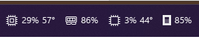
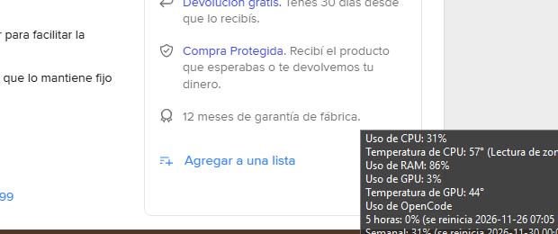
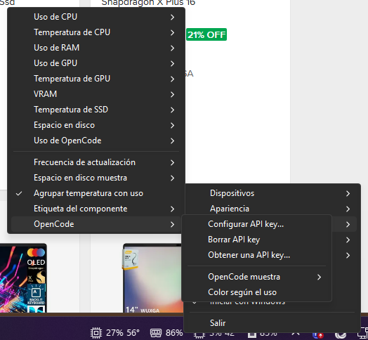
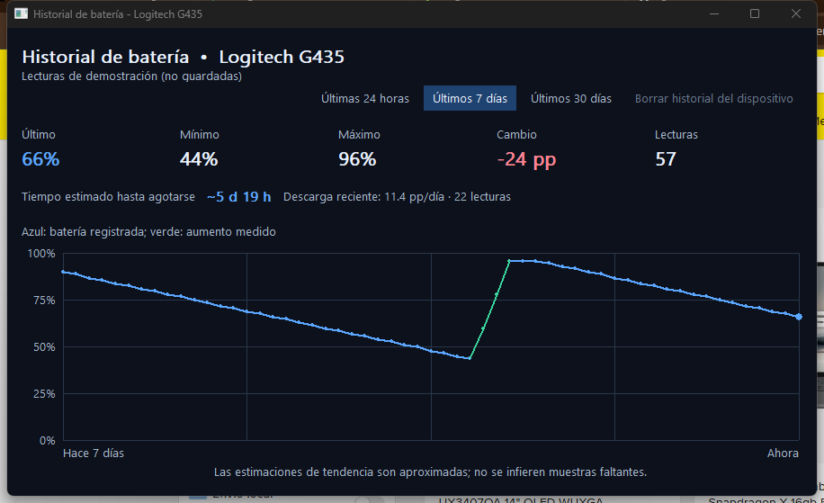

# Monitor

**Las baterías de tus dispositivos inalámbricos y las métricas de tu PC, en una sola franja de la barra de tareas de Windows.** App nativa en C++/Win32, sin dependencias externas, pensada para uso personal y para compartir con unos pocos amigos.

[](https://github.com/ignaciorevainera/monitor)
[](https://github.com/ignaciorevainera/monitor/issues/new)



## Qué muestra

Monitor reúne en una sola ventana invisible sobre la taskbar dos tipos de información:

- **Baterías inalámbricas:** ratones, teclados, auriculares, mandos, earbuds (Galaxy Buds, AirPods/Beats, Nothing/CMF, Google Fast Pair), dispositivos Bluetooth y teléfonos de Phone Link, además de auriculares compatibles con [HeadsetControl](https://github.com/Sapd/HeadsetControl). Incluye nombres personalizados, colores de marca, alertas de batería baja e historial local de 30 días.
- **Nueve métricas del sistema:** uso de CPU, temperatura de CPU, uso de RAM, uso de GPU, temperatura de GPU, VRAM, temperatura de SSD, espacio libre en disco y uso de OpenCode Go.

Cada métrica puede estar en la **barra de tareas**, en el **área de notificación** u **oculta**. El disco muestra GB libres, % libre o % usado (lee la unidad de Windows y se actualiza cada 60 s). OpenCode Go muestra `5 h / semanal / mensual` o **sólo el mensual con su `%`**, con color según el consumo que se puede activar o desactivar; usa el logo oficial de OpenCode y una clave API personal guardada cifrada con DPAPI (nunca lee la sesión local de OpenCode ni Gemini).

Puedes agrupar las temperaturas con su métrica de uso, elegir etiqueta de componente (**Icono**, **Palabra** o **Ambos**), ajustar la frecuencia (1/2/5 s) y activar alertas de temperatura y de uso con umbral configurable. Las alertas se disparan al cruzar el umbral hacia arriba; la primera muestra caliente al arrancar no avisa.



## Menú y configuración

Clic derecho sobre el widget abre un menú agrupado por tareas: **Dispositivos**, **Apariencia**, **Métricas del sistema**, **Alertas**, **Idioma**, **Actualizar ahora**, **Abrir Administrador de tareas**, **Iniciar con Windows** y **Salir**. Clic izquierdo abre el Administrador de tareas.



Cuando el taskbar se queda sin espacio, Monitor primero quita las palabras, luego reduce los espacios, después los glifos y por último oculta widgets completos, siempre con al menos un valor visible. Nunca aparece el botón de «…».

## Historial de batería

Cada dispositivo tiene su propio historial de 30 días: gráfico, mínimo/máximo, cambio y una estimación conservadora de autonomía a partir de la descarga reciente. Datos y estimaciones se guardan sólo en tu equipo.



## Instalación

Descarga el instalador o el portable desde la [última release](https://github.com/ignaciorevainera/monitor/releases/latest):

- **`Monitor-Setup.exe`:** instalador per-user; conserva ajustes, inicio automático e historial al actualizar. El upgrade es in-place, sin desinstalar.
- **`Monitor-1.1.x-portable.zip`:** descomprime y ejecuta `Monitor.exe`.

No hay firma Authenticode: SmartScreen puede avisar la primera vez (**Más información → Ejecutar de todos modos**). Verifica cualquier descarga contra el `SHA256SUMS.txt` de la release.

## Temperatura del núcleo de la CPU

`Monitor.exe` **nunca se eleva** y corre siempre con tu usuario normal. Para leer el sensor real del die de la CPU:

1. Elige **Métricas del sistema → Activar temperatura de CPU...**.
2. Aparece un único aviso de UAC: al aceptarlo se registra la tarea programada `MonitorTempHelper`, que ejecuta `Monitor.TempHelper.exe` con privilegios elevados al iniciar sesión.
3. El helper escribe la temperatura en un archivo temporal local que Monitor lee sin admin.

Cerrar Monitor u ocultar la métrica no desinstala la tarea: no volverá a pedir permiso.

## Espacio en el área de notificación

En Windows 11 los iconos nuevos del área de notificación aparecen dentro del desbordamiento (`^`). Para fijarlos, abre el desbordamiento y arrastra el icono a la barra, o actívalo en **Configuración → Personalización → Barra de tareas → Otros iconos del área del sistema**.

## Idiomas

Integrados: **español e inglés**, con selección automática según el idioma de Windows. Puedes añadir el tuyo copiando un archivo de idioma a la carpeta `lang` junto a `Monitor.exe`.

## Desde TraySense

Monitor reemplaza a TraySense. Si vienes de él: elimina su tarea programada y su carpeta de `Program Files`; tus ajustes antiguos se migran automáticamente la primera vez.

## Compilar desde el código

Necesitas **MinGW-w64** (`g++` y `windres` en el `PATH`) y PowerShell para `scripts/generate-version.ps1`:

```bat
build.bat 1.1.7 dev
```

Desde MSYS2 MINGW64:

```sh
make
make test
```

### Opciones de diagnóstico

- `--metrics-dump`: imprime una instantánea de las métricas disponibles y sale.
- `--list` / `--dump`: lista los dispositivos detectados o volca todos los HID.
- `--demo`: ejecuta con datos sintéticos (no se guardan).
- `--quit`: pide a la instancia en marcha que sala limpiamente.
- `--report`: abre el formulario para solicitar soporte de un dispositivo.

## Licencia y créditos

Monitor está bajo la **[GNU Affero General Public License v3.0 (AGPL-3.0)](LICENSE)** y se construye sobre:

- **[Wireless-Device-Battery-Monitor (BatteryHub)](https://github.com/krisgfx9/Wireless-Device-Battery-Monitor)**, de **krisgfx9** — GPL-3.0 (combinado bajo AGPL-3.0 §13).
- **[TraySense](https://github.com/DMTWEAKS/TraySense)**, de **DMTWEAKS** — AGPL-3.0 (lectura de métricas del sistema).
- **[PawnIO](https://github.com/namazso/PawnIO)**, de **namazso** — LGPL-2.1 (módulos de sensores usados por el helper).
- **[OpenCode](https://opencode.ai)**, de **Anomaly** — logotipo oficial de la marca usado sólo para identificar la métrica de uso de OpenCode Go; OpenCode es una marca de Anomaly y su uso no implica respaldo ni patrocinio.

Los detalles completos están en `installer/THIRD_PARTY_NOTICES.txt`.
