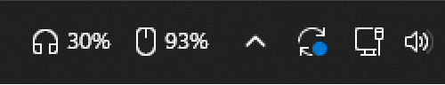

# Monitor

Wireless device battery levels and system metrics right on the Windows taskbar.

[](https://github.com/ignaciorevainera/monitor)
[](https://github.com/ignaciorevainera/monitor/issues/new)



## What Monitor shows

Monitor combines wireless peripheral battery tracking with real-time system telemetry in a single native C++/Win32 app:

- **Wireless device batteries:** mice, keyboards, headsets, game controllers, earbuds (Galaxy Buds, AirPods/Beats, Nothing/CMF, Google Fast Pair), Bluetooth devices, Phone Link phones, and [HeadsetControl](https://github.com/Sapd/HeadsetControl) headsets. Supports taskbar widget mode, tray-icon mode, brand colors, per-device low-battery alerts, custom device names, and local 30-day battery history.
- **Nine system metrics:**
  - **CPU usage** (`%`)
  - **CPU temperature** (`°C`)
  - **RAM usage** (`%`)
  - **GPU usage** (`%`)
  - **GPU temperature** (`°C`)
  - **VRAM** (`%`)
  - **SSD temperature** (`°C`)
  - **Disk space** (free GB / free % / used %; reads the Windows system drive and refreshes every 60 s)
  - **OpenCode Go usage** (5-hour / weekly / monthly; hidden by default until you set a personal API key from `https://opencode.ai/console/api`, stored encrypted with Windows DPAPI for your user account, and refreshed every 5 minutes; keys without an OpenCode Go subscription return 403, and Monitor never reads OpenCode's local session or Gemini)

OpenCode Go usage uses the official OpenCode logo, shown only for that metric.

Each metric can be placed on the **Taskbar**, in the **Notification area**, or **Hidden** via **System metrics** in the menu. You can also group temperatures with their usage metric, pick component label styles (**Icon**, **Word**, or **Both**), adjust refresh rate (1 s / 2 s / 5 s), and toggle **Temperature alerts** (on by default; rising-edge only, silent if a sensor is already hot at startup).

## Installation

Download from the [latest release](https://github.com/ignaciorevainera/monitor/releases/latest):

- **Installer (`Monitor-Setup.exe`):** standard Windows installer; keeps settings, startup choice, and battery history across updates.
- **Portable (`.zip`):** extract anywhere and run `Monitor.exe`.

Monitor is plain C++/Win32 with no external runtime required.

The binaries are not signed, so SmartScreen may warn the first time you run the installer: choose **More info → Run anyway**. To check a download, compare its SHA-256 against `SHA256SUMS.txt` in the same release.

## How CPU temperature works

`Monitor.exe` itself **never elevates** and always runs under your normal user account.

To read the CPU die temperature sensor via **PawnIO**, choose **System metrics → Turn on CPU temperature...** in the menu:

1. Monitor shows a one-time UAC administrator prompt.
2. Approving it registers a scheduled task (`MonitorTempHelper`) that runs `Monitor.TempHelper.exe` at logon with elevated privileges.
3. `Monitor.TempHelper.exe` loads the PawnIO sensor module and writes the CPU die temperature to a local temp file that `Monitor.exe` reads without admin rights.

Closing Monitor or hiding CPU temperature keeps the helper task installed so you are not prompted again.

## Windows 11 tray overflow

On Windows 11, newly created notification-area icons (such as system metrics set to **Notification area**) are placed in the hidden overflow flyout (`^`) by default. To keep an icon permanently visible on the taskbar, open the overflow flyout and drag the icon onto the taskbar, or enable it under **Settings → Personalization → Taskbar → Other system tray icons**.

## Coming from TraySense

Monitor supersedes TraySense. If you previously used TraySense:

1. **Retire TraySense:** delete its scheduled task in Task Scheduler and remove its folder from `Program Files`.
2. **Automatic migration:** your existing TraySense settings are migrated to Monitor automatically on first run.

## Building from source

Requires **MinGW-w64** (`g++` and `windres` on `PATH`) and PowerShell (used by `scripts/generate-version.ps1`):

- **Batch script (Windows):**
  ```bat
  build.bat
  ```
  Produces `Monitor.exe` and `Monitor.TempHelper.exe`.
- **Make (MSYS2 MINGW64):**
  ```sh
  make
  make test
  ```

### Diagnostic CLI options

- `--metrics-dump`: prints a single snapshot of available system metrics to stdout and exits.
- `--list` / `--dump`: lists detected wireless devices or full HID/driver diagnostics (for GitHub device-support reports).
- `--demo`: runs with synthetic demo data (not saved).
- `--quit`: signals a running `Monitor.exe` instance to exit cleanly.

## License & Credits

Monitor is licensed under the **[GNU Affero General Public License v3.0 (AGPL-3.0)](LICENSE)**.

Monitor builds on and credits:

- **[Wireless-Device-Battery-Monitor (BatteryHub)](https://github.com/krisgfx9/Wireless-Device-Battery-Monitor)** by **krisgfx9** — GPL-3.0 (combined under AGPL-3.0 §13)
- **[TraySense](https://github.com/DMTWEAKS/TraySense)** by **DMTWEAKS** — AGPL-3.0 (system metrics reading)
- **[PawnIO](https://github.com/namazso/PawnIO)** by **namazso** — LGPL-2.1 (sensor modules used by `Monitor.TempHelper.exe`)
